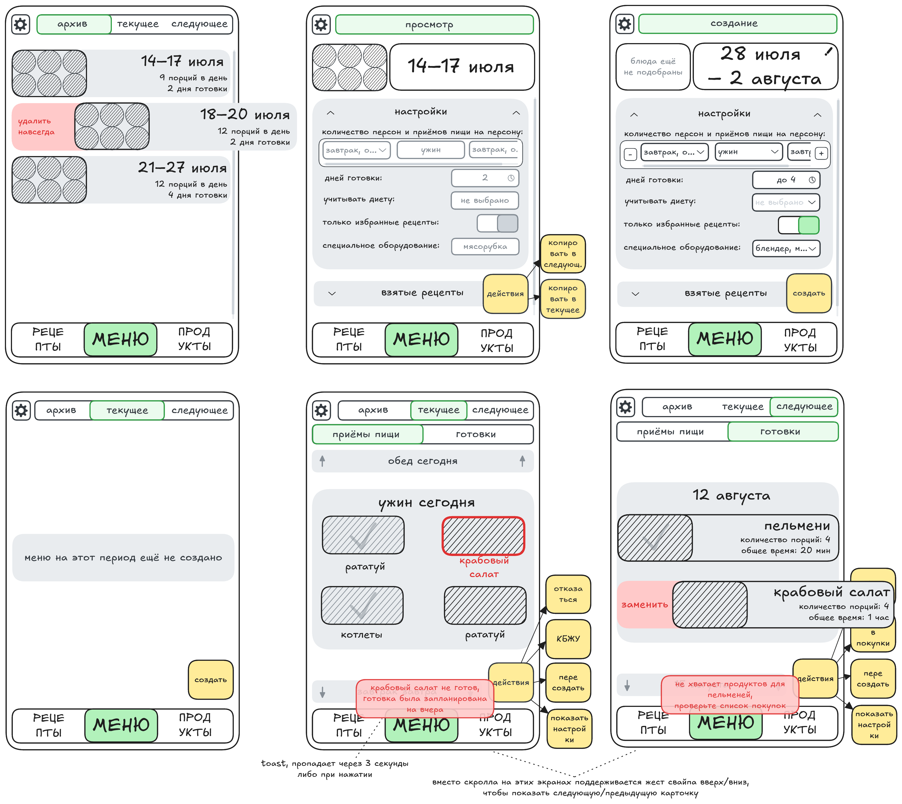
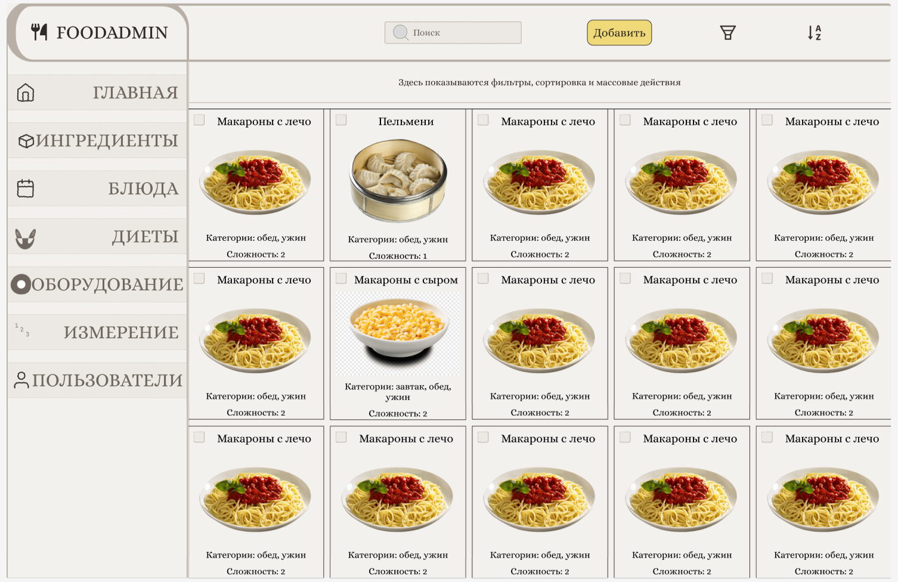

# hse-web-programming-2026
ДЗ по курсу https://github.com/two-devs-teaching/hse-web-programming-2026

## Описание проекта

6 экранов --- подразделы раздела "Меню" мобильного приложения, помогающего планировать питание.

Десктопная (адаптивная) версия ещё не нарисована, будет выполнена в рамках ДЗ. Референс --- 1 [экран](https://www.figma.com/design/fOz8YGb0RfQ36GAV2kSQjA/%D0%9C%D0%973?node-id=0-1&t=sKi788Wj4WEwThQE-1) приложения-компаньона для наполнения БД.

